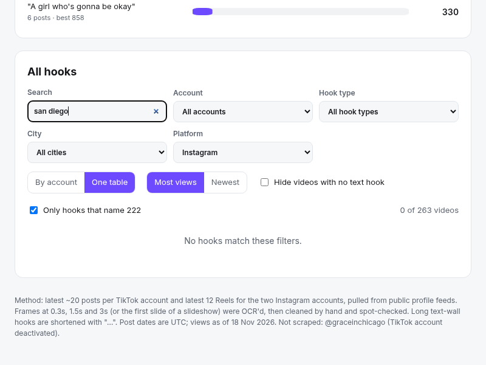
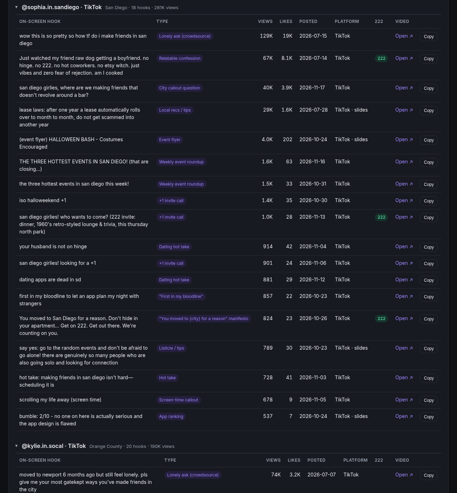

# 222 ambassador text hooks

A hand-checked dataset and an interactive dashboard of the **on-screen text hooks** used by [222.place](https://222.place) ambassador creators on TikTok and Instagram Reels.

An on-screen text hook is the text overlay a viewer reads in the first ~3 seconds of a short video, for example *"SF girls, where are we making friends that doesn't revolve around a bar??"* over a clip of someone at a bar. It is **not** the post caption. 222 is an IRL social / friend-making app that matches strangers for dinners and events. Its ambassadors post dozens of variations of the same few hooks, which makes their accounts a good swipe file for anyone writing UGC or paid-social creative for a consumer app.

**[Open the dashboard →](index.html)** (or see [How to open the dashboard](#how-to-open-the-dashboard))



| | |
|---|---|
| Videos read | **263** (about 20 latest per TikTok account, 12 latest Reels per Instagram account) |
| Accounts | **13 of 14** (`@graceinchicago` is deactivated) |
| Videos with an on-screen hook | **256** (7 are talking-head videos with spoken subtitles only) |
| Hooks that name "222" on screen | **80** (31%) |
| Median views | **857** (1.5M views across all 263) |
| Data as of | 18 Nov 2026 |

## What's in the repo

```
index.html                 Self-contained dashboard (data embedded, no network calls)
data/222_hooks.csv         The dataset: one row per video (263 rows)
data/hook_templates.json   12 reusable hook templates with {placeholders} and proof
docs/                      Screenshots
scripts/                   The pipeline that produced the data (see below)
  accounts.json            Which accounts to scrape, with their city
  01_fetch_listings.py     List recent posts per account (APIs)
  02_download_frames.py    Download videos, grab frames at 0.3s / 1.5s / 3s
  03_ocr_frames.py         OCR every frame (RapidOCR)
  04_make_draft.py         Join listings + OCR into a draft CSV for manual cleanup
  contact_sheet.py         Optional: tile frames to eyeball overlay text
  05_build_csv.py          Cleaned draft -> data/222_hooks.csv
  06_build_dashboard.py    CSV + templates -> index.html
  dashboard_template.html  HTML/CSS/JS shell the build fills with data
  test_dashboard.mjs       Headless smoke test for index.html
```

## Key findings

1. **The biggest hits don't pitch the app in the hook.** They open with a city name plus a loneliness or "where do I make friends" ask, and 222 appears later in the video or in the comments. The top post (128.6K views) is *"wow this is so pretty so how tf do i make friends in san diego"* over scenic b-roll.
2. **The most-posted, app-first hooks underperform.** *"first in my bloodline to let an app plan my entire night with strangers"* (16 posts) has a median of 742 views. *"A girl who's gonna be okay (just went to a 222 event)"* (6 posts) has a median of 329.
3. **Crowdsourcing asks drive comments.** *"moved to {city} 6 months ago but still feel lonely… give me your most gatekept ways…"* reached 74.0K (Orange County) and 38.6K (London). It invites replies, and ambassadors answer with "222!" in comment-reply videos.
4. **Utility formats travel well on Instagram.** "5 apps every Londoner needs" (67.5K, 61.1K, 50.7K) and "5 ways to actually make new friends in your 20s" (88.6K) slot the app into a useful list.
5. **Hooks are templated across the program.** The same scripts ("You moved to {city} for a reason…", "{city} girls, where are we making friends…", "giving myself until thanksgiving…") show up across cities with only the city swapped. Ambassadors are clearly working from a shared hook bank.

### Median views by hook type (types with 4+ posts)

| Hook type | Posts | Median views | Best |
|---|---:|---:|---:|
| Failed attempts list | 4 | 3,597 | 17,645 |
| Weekly event roundup | 9 | 1,512 | 15,602 |
| App roundup | 22 | 1,391 | 67,495 |
| Listicle / tips | 19 | 1,242 | 88,610 |
| Lonely ask (crowdsource) | 33 | 1,005 | 128,608 |
| Seasonal genuine question | 8 | 1,002 | 8,767 |
| +1 invite call | 8 | 963 | 3,190 |
| "You moved to {city} for a reason" manifesto | 25 | 925 | 22,036 |
| City callout question | 6 | 862 | 39,996 |
| Relatable confession | 6 | 855 | 66,741 |
| "First in my bloodline" | 16 | 742 | 1,193 |
| Social proof / outcome story | 14 | 722 | 83,885 |
| "A girl who's gonna be okay" | 6 | 329 | 858 |

The full list is in the dashboard. Medians are small samples, so treat them as directional.

## Top hook templates

Placeholders are in `{braces}`. "Proof" is the view count of the best posts that used the pattern. The same list is in [`data/hook_templates.json`](data/hook_templates.json), and each one has a Copy button in the dashboard.

| # | Template | Pattern | Proof (views) |
|---:|---|---|---|
| 1 | wow this is so pretty… so how tf do i make friends in {city} | Lonely ask over scenic b-roll | 128.6K, 39.2K |
| 2 | {city} girls, where are we making friends that doesn't revolve around a bar?? | City callout question | 40.0K, 11.2K |
| 3 | moved to {city} {6} months ago but still feel lonely. pls give me your most gatekept ways you've made friends in the city | Lonely ask (crowdsource) | 74.0K, 38.6K |
| 4 | just moved to {city} and I need your most gatekept ways to actually meet people. not just {obvious spot} or {obvious spot}. give me the wildest, most unhinged, actually-works ways you've made real friends here | Lonely ask (crowdsource) | 45.8K, 15.7K, 7.7K |
| 5 | 5 ways to actually make new friends in your 20s: 1) Become a regular somewhere… | Listicle / tips | 88.6K, 36.1K |
| 6 | met on {app} last year and now we {fly round the world / see our favorite artists together} | Social proof / outcome story | 83.9K, 18.0K |
| 7 | 5 apps that make living in {city} so much easier (slot your app in the list) | App roundup | 67.5K, 61.1K, 50.7K |
| 8 | Just watched my friend raw dog getting a boyfriend. no hinge. no {app}. no hot coworkers. just vibes and zero fear of rejection. am I cooked | Relatable confession | 66.7K |
| 9 | giving myself until {holiday} to make one real friend in {city}. tell me where to go and I'll try every single one (within reason) | Deadline challenge | 24.5K, 3.1K |
| 10 | You moved to {city} for a reason. Don't hide in your apartment. Get up. Get dressed. Meet new people… Get on {app}. Get out there. | Manifesto (most reused: 25 posts) | 22.0K, 7.2K |
| 11 | my attempts at making friends in {city} so far: run club (nobody texted after). pottery class (all couples). bumble bff (ghosted twice). what am i missing | Failed attempts list | 17.6K, 5.2K |
| 12 | BEST {HALLOWEEN} EVENTS IN {city} (one of them on {app}) | Seasonal event roundup | 15.6K |

## How to open the dashboard

`index.html` is a single file with the data, CSS and JS inline. It makes no network requests and needs no build step or server.

- **Locally:** download or clone the repo and double-click `index.html`, or drag it into any modern browser.
- **GitHub Pages:** in the repo, go to *Settings → Pages → Build and deployment*, choose *Deploy from a branch*, then `main` / `/ (root)`. The dashboard will be served at `https://<user>.github.io/<repo>/`.

What you can do in it:

- Group the table by account or show one combined table, and sort by most views or newest.
- Filter by account, hook type, city and platform, or search the hook text.
- Hide videos with no text hook, or show only hooks that name 222.
- Use **Open ↗** to go to the video, **Copy link** for its URL and **Copy** for the hook text.
- Switch between Auto, Light and Dark themes (Auto follows your system setting).



## How the pipeline works

```
accounts.json
   │  01_fetch_listings.py   recent posts per account (TikTok: ScrapeCreators, Instagram: TikHub)
   ▼
work/raw/*.json
   │  02_download_frames.py  download each video, ffmpeg frames at 0.3s, 1.5s, 3.0s
   ▼                         (photo slideshows: first 2 slides)
work/frames/*.jpg
   │  03_ocr_frames.py       RapidOCR on every frame
   ▼
work/ocr.json
   │  04_make_draft.py       one row per video with OCR text per frame + a pre-filled hook_text
   ▼
work/hooks_draft.csv  ──►  MANUAL CLEANUP: fix spacing and typos, drop burned-in spoken
   │                       subtitles, set hook_type, mark "No text hook"
   │  05_build_csv.py
   ▼
data/222_hooks.csv
   │  06_build_dashboard.py  + data/hook_templates.json + scripts/dashboard_template.html
   ▼
index.html
```

Why the manual step matters: OCR on stylized TikTok text often drops spaces ("wherearewe"), and it also reads the auto-captions of what the creator is saying. Every hook in the published CSV was cleaned by hand, and the ambiguous ones (empty OCR, mixed overlay and subtitles) were checked against the frames with `contact_sheet.py`. Very long text-wall hooks are shortened with "…" after the opening lines.

## Rerun it on new accounts

Requirements: Python 3.10+, `ffmpeg` and `curl` on your PATH, and API keys for the listing step.

```bash
python -m venv .venv && source .venv/bin/activate
pip install -r requirements.txt

cp .env.example .env              # fill in your keys; .env is git-ignored
set -a && source .env && set +a   # or export the variables yourself
```

| Env var | Used by | What it is |
|---|---|---|
| `SCRAPECREATORS_API_KEY` | `01_fetch_listings.py` | [ScrapeCreators](https://scrapecreators.com) key for TikTok profile listings |
| `TIKHUB_API_KEY` | `01_fetch_listings.py` | [TikHub](https://tikhub.io) key for Instagram Reels listings |
| `HOOKS_WORKDIR` (optional) | all steps | Where raw data, videos and frames go. Default: `./work` (git-ignored) |
| `HOOKS_ACCOUNTS` (optional) | 01, 04 | Path to an alternative accounts file. Default: `scripts/accounts.json` |

No keys are stored in this repo. The scripts read them from the environment and exit with a message if one is missing.

1. Edit `scripts/accounts.json`: add `{"handle": "...", "city": "..."}` entries under `tiktok` or `instagram`.
2. Run the pipeline. Steps 1 and 2 should run back to back, because the video URLs in the listings expire within hours.
   ```bash
   cd scripts
   python 01_fetch_listings.py --pages 2          # ~20 TikToks per account; --only a,b for a subset
   python 02_download_frames.py
   python 03_ocr_frames.py                        # ~4–5 min per ~750 frames on 8 cores
   python 04_make_draft.py
   python contact_sheet.py check.jpg <post_id> <post_id>   # optional, to eyeball frames
   ```
3. Open `work/hooks_draft.csv` and clean the `hook_text` and `hook_type` columns. Rows with no overlay get `hook_type` = `No text hook`.
4. Build:
   ```bash
   python 05_build_csv.py
   python 06_build_dashboard.py
   ```
5. Optional smoke test (needs Node 18+ and Chrome):
   ```bash
   npm i puppeteer-core
   CHROME_PATH=/usr/bin/google-chrome node scripts/test_dashboard.mjs 263
   ```

To change the templates section, edit `data/hook_templates.json` and rerun step 6. To change the look of the dashboard, edit `scripts/dashboard_template.html`. Its `__DATA__` and `__TEMPLATES__` placeholders are filled in by the build.

## Data dictionary: `data/222_hooks.csv`

| Column | Type | Description |
|---|---|---|
| `account` | string | Creator handle, with `@` |
| `platform` | `TikTok` \| `Instagram` | Where the post lives |
| `format` | `Video` \| `Slideshow` | TikTok photo slideshows are `Slideshow`; their hook is the first slide |
| `city` | string | The city the account targets (from `accounts.json`) |
| `post_date` | `YYYY-MM-DD` | Post date in UTC |
| `views` | integer | Play count as of 18 Nov 2026 |
| `likes` | integer | Like count as of 18 Nov 2026 |
| `hook_text` | string | On-screen text in the first ~3s, hand-cleaned. "…" marks a shortened text wall. Values starting `NO TEXT HOOK` describe videos without an overlay. Text in `(parentheses)` is an editor's note (e.g. what a screenshot shows) |
| `hook_type` | string | Hand-assigned hook pattern, e.g. `City callout question`, `Lonely ask (crowdsource)`, `"First in my bloodline"`, `No text hook` |
| `hook_mentions_222` | `yes` \| `no` | Whether "222" appears in the on-screen hook |
| `caption_mentions_222` | `yes` \| `no` | Whether "222" appears in the post caption or hashtags |
| `video_url` | URL | Link to the post |
| `caption` | string | The post caption/description, kept for reference (not the hook) |

## Limitations

- **Instagram coverage is shallow:** only the 12 most recent Reels for `@dylanw.irl` and `@unverifiedtram`. TikTok accounts have about 20 recent posts each (19 for `@jenna.in.toronto`).
- **`@graceinchicago` is missing:** TikTok reported the account as deactivated on 18 Nov 2026.
- **Counts are a snapshot:** views and likes are as of 18 Nov 2026 and will drift. Recent posts had less time to accumulate views than older ones, so compare like with like.
- **Recent posts only:** this is the latest ~20 posts, not each creator's all-time best. Pinned older posts appear where the platform returned them.
- **Labels are one person's judgement:** hook text was cleaned and hook types were assigned by hand. Long hooks are shortened, and spoken subtitles are excluded by design.
- **Views aren't only about the hook:** they depend on the visual, audio, posting time and account size too. Treat the medians as directional, not causal.

## Disclaimer

All videos, text and other content referenced here belong to their respective creators and to 222. This repo is an independent research and analysis project. It is not affiliated with or endorsed by 222, TikTok or Instagram. Hook texts are quoted for commentary and research; the dataset holds links to public posts and no media files. If you are one of the creators and want your content removed, please open an issue.

The MIT license covers the code and the dashboard. It does not grant any rights to the creators' content.

## License

[MIT](LICENSE)
